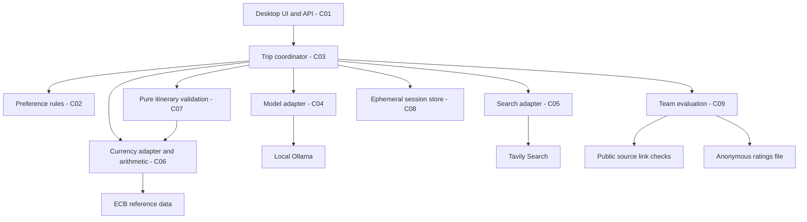
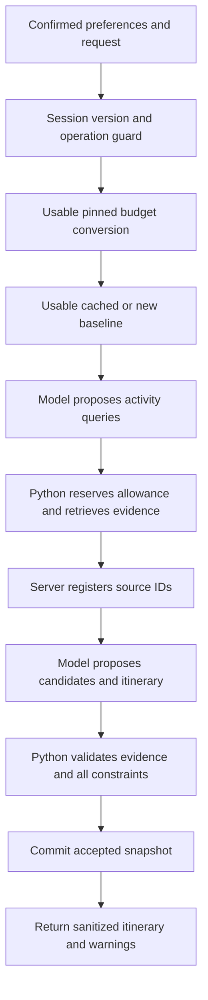

# Component Dependencies and Data Flow

Status: Application Design artifacts approved by the team with "approve & continue", recorded 2026-11-25T02:02:35Z. Units Generation may begin. No implementation, integration, performance or test success is claimed.

## Dependency matrix

A row calls a column. D means ordinary internal typed calls; P means only the pure arithmetic interface. A dash means no direct component dependency. Shared contract types and runtime configuration are common data definitions, not extra deployed services.

| Caller | C01 | C02 | C03 | C04 | C05 | C06 | C07 | C08 | C09 |
| --- | --- | --- | --- | --- | --- | --- | --- | --- | --- |
| C01 UI/API | - | - | D | - | - | - | - | - | - |
| C02 Preferences | - | - | - | - | - | - | - | - | - |
| C03 Coordinator | - | D | - | D | D | D | D | D | D |
| C04 Model | - | - | - | - | - | - | - | - | - |
| C05 Search | - | - | - | - | - | - | - | - | - |
| C06 Currency | - | - | - | - | - | - | - | - | - |
| C07 Validation | - | - | - | - | - | P | - | - | - |
| C08 Session store | - | - | - | - | - | - | - | - | - |
| C09 Evaluation | - | - | - | - | - | - | - | - | - |

C03 passes immutable context to C07 and validated final snapshots to C09. C05 returns evidence to C03, which registers it through C08; adapters cannot mutate canonical state. C07 uses C06's pure conversion operations, never its network acquisition method. C09 owns its bounded link-check/file side effects and receives no raw chat/profile data for persistence. Dependencies therefore remain acyclic.

## External and storage boundaries

| Component | External boundary | Direction / retained data |
| --- | --- | --- |
| C01 | Local desktop Chrome/Safari | Loopback same-origin HTTP; sanitized display and typed commands |
| C04 | Local Ollama at localhost:11434/v1 | OpenAI-compatible client; bounded prompts and structural proposals; model is planned, not verified |
| C05 | Tavily Search over HTTPS | Only necessary destination/dates/interests in queries; results registered in session memory; no entire conversations |
| C06 | Official ECB reference-data download over HTTPS | Dated rate table; no traveler data sent; pinned in server memory |
| C09 | Session-owned public source links | Bounded HTTP/HTTPS availability checks with safe target/redirect validation; no credentials, private/local services or page scraping |
| C08 | Process memory only | Trip state/evidence/counters/receipts expire/reset together; no database or browser persistence |
| C09 | Local ratings.jsonl | Six anonymous field groups only; ignored by Git and removed after demo |

Secrets stay in runtime environment variables. The provider adapters and coordinator must account for any automatic client retries so hidden attempts cannot bypass limits. Library versions, licenses, Tavily entitlement and measured compatibility are later verification tasks; no new package is installed by these diagrams.

## Component communication diagram

Text alternative: UI/API calls the coordinator. It calls preferences, model/search/currency adapters, validation, session store and evaluation. Model, search and rate acquisition call only their designated providers. Validation has a pure arithmetic dependency on Currency, not permission to fetch rates. Evaluation checks eligible public source links and writes the anonymous file. The diagram's component arrows summarize allowed calls, not a guarantee that every operation invokes every dependency.

## Successful generation data flow

Text alternative: a confirmed command passes session/version guards, budget conversion and baseline prerequisites. Python controls query/search execution and registers retrieved sources. The model drafts from that evidence. Python checks the whole result before committing it and returning the browser view. Cached candidates can skip new searches. This diagram shows the successful path; missing budget rates, unusable baselines, invalid references and timeouts exit safely as specified in [services.md](services.md), preserving prior accepted state and consumed quotas.

## Revision and evaluation data flow

A revision starts with a canonical snapshot and current thumbs-down IDs. Cached baseline/rates and fixed activities enter its validation context; only candidate replacement data is proposed. The validator checks that fixed fields remain identical before C08 commits. Feedback alone updates ratings without passing through search/generation.

After the team deliberately ends an evaluation, C03 sends the validated final snapshot to C09. C09 checks its resolved source URLs, calculates anonymous arrays/counts and writes only the approved record projection. Raw sources, preferences and session IDs remain in memory and are not inputs to the record serializer. Aggregate failures/completeness are displayed separately rather than inventing successful records.

## Validation and later work

Both Mermaid diagrams use a restricted quoted-node/arrow grammar. Node IDs, declarations and edges were structurally validated before creation; text alternatives are included. No graphical render is claimed. Units Generation will formalize code organization and story-to-module mapping after design approval. Detailed algorithms, async mechanics inside the open HTTP request, locks, provider clients and tests belong to Construction.
