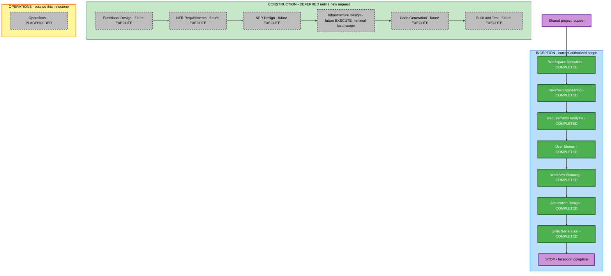

# Execution Plan

Status: Workflow Planning approved by the team; recorded 2026-11-25T01:20:13Z. Raw approval: "approve and continue ". Latest checkpoint: Application Design separately approved at 2026-11-25T02:02:35Z; Units plan approved at 2026-11-25T02:12:10Z; all three unit artifacts explicitly approved with "approve and finish inception " at 2026-11-25T02:27:53Z; Inception complete and stopped before Construction. This plan does not authorize Construction.

## 1. Remaining work and scope

All seven Inception stages are complete: Workspace Detection, limited Reverse Engineering, Requirements Analysis, User Stories, Workflow Planning, Application Design, and Units Generation. Final Units approval is recorded; work has stopped before Construction.

The user-requested finish line has been reached: Units Generation is explicitly approved, followed by a stop before Construction. All required milestone Inception stages executed; none was skipped.

Source context: [requirements and intent](../requirements/requirements.md), [recorded original answers](../requirements/requirement-verification-questions.md) and their later clarifications, [approved stories](../user-stories/stories.md), [approved personas](../user-stories/personas.md), the reverse-engineering architecture/component/stack/dependency artifacts, the attached milestone, AGENTS.md and installed stage rules. The 19 FRs, 6 NFRs, 17 stories, 59 acceptance scenarios, and all 7 DEF items remain the approved behavioral scope.

## 2. Detailed scope and impact analysis

### Existing-code transformation and coordination

This is a new product with a pre-existing standalone date-validation example. Workspace detection routed it through limited Reverse Engineering because source code existed; that does not make it a deployed planner or a system migration.

| Existing component | Relationship | Planned impact now |
| --- | --- | --- |
| examples/trip-validation/main.py | Calls the pure rule in rules.py; imported by its API tests | Preserve; no example-code change in Inception |
| examples/trip-validation/rules.py | Inclusive date calculation used by main.py/tests | Preserve; use its separation-of-concerns pattern as context only |
| examples/trip-validation/test_trip.py | Imports main.py and rules.py; uses TestClient | Preserve; no test execution or passing-result claim |
| Example README | Documents manual environment/test setup | Preserve |
| Root input documents | Product and environment agreements | Reconcile only actual team-requested decisions through the workflow |

No application dependency manifest, shared-package version scheme, infrastructure-as-code, API gateway, load balancer, cloud network, production database or deployment pipeline exists to migrate. Package release ordering, infrastructure migration, production rollback and cross-package compatibility updates are N/A. Do not invent package versions or a cloud rollout.

The approved product is one local modular Python application. The installed Units rule treats a monolith as one application unit with logical modules. Units Generation will formalize that organization, internal dependencies, and story mapping rather than introduce independently deployed microservices. No implementation assignments or final module boundaries are chosen by this workflow plan.

### Change impact

| Area | Impact and evidence | Treatment |
| --- | --- | --- |
| User experience | New intake, discovery, schedule/cost review, ratings, targeted updates, and evaluation flows | Preserve the 17 approved story outcomes and their failure cases |
| Structure | New preferences, retrieval, model, currency, itinerary, session, evaluation and interface responsibilities | Determine concrete component boundaries/interfaces in Application Design |
| Data | Typed preferences/candidates/itineraries; session-owned sources and cached baseline; anonymous ratings | Define contracts and lifecycle without adding a database or persistent accounts |
| APIs | Planned local typed chat/feedback interactions, session identifiers, validated source references | Define interfaces and expected responses; no endpoints implemented now |
| External integrations | Planned Tavily search, local Ollama model and ECB reference data selected in AD4 | Preserve approved choices and verify runtime integration during Construction |
| Non-functional behavior | Local operation, privacy, bounded requests, accessibility, testing, measured performance | Carry all NFRs into design and later verification; disabling extensions does not remove these requirements |
| Infrastructure/operations | Laptop-only app/Ollama, external HTTPS, minimal runtime configuration | No cloud resources, public deployment, new monitoring service, or operational rollout |

### Risks and recovery

Overall project planning risk is **Medium**: multiple interacting rules and unverified integrations, within a limited local demonstration scope. Inception document recovery is low complexity; preserve prior content/answers and use reviewable edits. Future testing complexity is moderate because nondeterministic model output must be checked through deterministic boundaries and controlled integration tests.

| Risk | Consequence | Planned treatment |
| --- | --- | --- |
| Rate integration remains unverified | A documented format still requires working parsing/failure behavior | AD4 selected ECB after WSJ remained unverified; verify in Construction without silent provider substitution |
| Currency policy and fixtures now selected | Actual results remain unmeasured | AD3/AD5/AD6 resolve DEF-01/03; verify with actual Construction tests/evaluation |
| Baseline matching, session ownership and revision invariants interact | Invalid recommendations or unintended changes could pass through | Define contracts, evidence ownership and validation responsibilities under DEF-04 |
| Model quality, memory and tool-call behavior are not tested | Construction may need the planned fallback or a revised decision | Retain DEF-06 for measured Construction evidence; do not claim readiness now |
| Service limits and dependencies are not verified | Integration could exceed accessible limits or require changes | Verify DEF-07 before integration; no purchase or provider account assumed |
| Extra product scope appears during design | Increased work and inconsistent input documents | Record actual requested changes, update affected artifacts, and seek approval for the concrete changed scope |

## 3. Inception stages and detail

| Stage | Decision / current status | Depth | Reason and required outcome |
| --- | --- | --- | --- |
| Workspace Detection | EXECUTED | Focused | Existing-code routing and original inputs recorded |
| Reverse Engineering | EXECUTED and approved | Focused | Existing example inventory/architecture/stack/dependencies; no product implementation claim |
| Requirements Analysis | EXECUTED and approved | Standard | Functional/non-functional requirements, exact answers, acceptance criteria and deferrals |
| User Stories | EXECUTED and approved | Standard | Three traveler personas plus evaluation role; 17 stories and complete coverage |
| Workflow Planning | EXECUTED and approved | Standard | Scope/impact/risk assessment, stage sequence, deliverables, review boundaries and stop condition |
| Application Design | EXECUTED and approved | Standard | New component responsibilities, interfaces, orchestration and dependencies need definition; milestone requires its artifacts |
| Units Generation | EXECUTED and approved | Standard | Formalize application/module organization and map every story; milestone requires unit/dependency/story-map artifacts even for one local application |

### Application Design deliverables and review

- [x] Prepare application-design-plan.md with execution checkboxes and questions specific to unresolved interfaces, orchestration, dependencies and deferred decisions.
- [x] Collect actual team answers, resolve ambiguity, and confirm the concrete approach before generation as required by the installed design rules.
- [x] Create application-design/components.md: responsibilities and interfaces.
- [x] Create application-design/component-methods.md: method signatures, high-level purpose, input/output expectations; defer detailed algorithms to later Functional Design.
- [x] Create application-design/services.md: orchestration responsibilities and interactions within the existing local application boundary.
- [x] Create application-design/component-dependency.md: dependency matrix, communication patterns and data-flow diagrams/text alternatives.
- [x] Create application-design/application-design.md: consolidated design.
- [x] Resolve or explicitly review the design-stage DEF items below, validate consistency against requirements/stories, and present the design and updated audit/state for approval.

### Units Generation deliverables and review

- [x] Prepare unit-of-work-plan.md; evaluate story grouping, dependencies, team alignment, technical/deployment boundaries, business domains and code organization without re-asking settled product decisions.
- [x] Collect actual answers, resolve ambiguity, and obtain explicit approval of the decomposition plan.
- [x] Create application-design/unit-of-work.md with the application unit, logical-module responsibilities, and code organization for the new product.
- [x] Create application-design/unit-of-work-dependency.md with internal/external dependency relationships and a matrix; do not invent multiple deployed services to populate it.
- [x] Create application-design/unit-of-work-story-map.md assigning every US-01 through US-17 to the agreed unit/module structure.
- [x] Check boundaries, dependency consistency, all story/NFR coverage, audit and state; present generated unit artifacts for explicit approval.
- [x] After that approval, mark Inception complete and STOP. Do not begin Functional Design or any Construction activity.

All Inception checklist items are complete; final Units approval is recorded and the requested stop is in effect. UG1=A retains shared team ownership with work divided in meetings; Sophia remains the shared-session operator, without invented permanent module assignments.

## 4. Explicit deferrals and verification work

| ID | Item | Required stage/outcome | Decision source |
| --- | --- | --- | --- |
| DEF-01 | Three cities and ten fixtures | Resolved by AD3: New York City/London/Paris, 4/3/3; run evaluation later | AD3=A |
| DEF-02 | Rate-source access decision (originally WSJ) | AD4 explicitly replaces WSJ with documented ECB data; runtime ingestion/integration still unverified | AD4=A |
| DEF-03 | Currency and missing-budget policy | Resolved at design level by AD5/AD6; detailed arithmetic/date tests later | AD5/AD6=A |
| DEF-04 | High-level interfaces, lifecycle, normalization and bounds | Defined under AD1/AD2/AD6; detailed schemas, algorithms and remaining evidence/link bounds in Functional/NFR Design | AD1/AD2/AD6=A |
| DEF-05 | PBT framework and dependency configuration | Later design/NFR selection: review appropriate framework, then configure in Construction | Q18; PBT-09 |
| DEF-06 | Model quality, laptop suitability, latency/memory targets and fallback hardware | Construction: test actual environment and record evidence; return changed choices to team | R, T |
| DEF-07 | Tavily account access/limits, dependency versions and licenses | Design/Construction before integration: verify availability/cost and pin tested dependencies; no purchase assumed | T |

DEF-02 was returned to the team after the limited WSJ check. AD4=A explicitly selects ECB's documented structured reference data. This resolves the source decision without claiming either integration works; runtime download/parsing and failure verification remain Construction work.

## 5. Workflow visualization

The current path ends at STOP. The disconnected Construction/Operations sections describe future stages only; they are not reachable steps in this authorized run. Green indicates completed Inception work; gray indicates deferred work outside this milestone.

### Text alternative

1. Completed: Workspace Detection, limited Reverse Engineering, Requirements Analysis, User Stories, Workflow Planning, Application Design, Units Generation.
2. The execution plan is approved.
3. Current: All three Units artifacts are explicitly approved; Inception is complete.
4. Final approval of unit-of-work.md, unit-of-work-dependency.md and unit-of-work-story-map.md recorded at 2026-11-25T02:27:53Z in audit/state.
5. STOP reached. Construction has not started and requires a later explicit request.
6. Future only: per-unit Functional Design, NFR Requirements, NFR Design, minimal local Infrastructure Design, Code Generation; then Build and Test. Operations is a placeholder outside this milestone.

Validation: the simple quoted-label flowchart syntax, balanced subgraphs, node/edge/style references and stop-path reachability were checked before writing. No Mermaid renderer is installed in the current shell; this is structural source validation, not a claim of visual rendering. The text alternative is authoritative if a viewer cannot render the diagram.

## 6. Construction outlook — deferred, not authorized now

These are provisional planning recommendations for the later final-project request. Their exact per-unit application must be revisited against the approved design and unit plan. Planning them does not start them, select a new dependency, or configure a runtime.

| Stage type | Future recommendation | Depth / reason |
| --- | --- | --- |
| Functional Design | EXECUTE later for the application unit | Standard: schemas, scheduling/currency rules and state transitions require detailed logic design |
| NFR Requirements | EXECUTE later | Standard: performance, privacy, bounded calls and partial-PBT framework selection |
| NFR Design | EXECUTE later | Standard: implement the agreed quality/security/testing constraints within the local architecture |
| Infrastructure Design | EXECUTE later, local scope only | Minimal: map app/Ollama locations, external-service configuration, environment variables and local runtime boundaries; no cloud resources |
| Code Generation | EXECUTE later | Plan approval then code/tests, following the approved unit plan |
| Build and Test | EXECUTE later, after unit completion | Unit/API/integration/browser checks, model measurements, PBT and evaluation instructions/results |
| Operations | PLACEHOLDER; excluded | No operations work is requested for this milestone |

No Inception stage is skipped. Construction and Operations are deferred by the user's scope boundary, not recorded as completed or unnecessary. The team may request changes to stage selection or depth; any change conflicting with required milestone artifacts must be made explicit rather than silently dropping deliverables.

## 7. Coordination and verification checkpoints

- Existing example package updates: N/A; preserve all example files. No shared package release sequence exists.
- Design coordination: agree contracts and responsibilities before formalizing unit/module boundaries. A single local deployment remains the approved model.
- Units coordination: record story affinities, dependencies and team ownership choices together; do not assign a module to a teammate without an actual decision.
- Future implementation coordination: use the approved dependencies to sequence the per-unit work. No parallel agent work, separate workflows, or new implementation branch is started here.
- Future verification: unit/API checks must pass before merging; live integration and browser checks precede the final demo. Keep mocked routine tests and partial PBT obligations. This plan reports no tests executed.
- All current work is documentation. External purchases, publishing, submitting to Canvas, and committing/pushing this Inception package are separate actions and are not performed by this plan.

## 8. Estimated remaining effort

**Rough planning estimate: about 1–2 hours of active drafting and team review**, assuming prompt answers and no substantial scope changes. This is not a completion guarantee or a measured deadline estimate; waiting between team sessions is additional.

| Remaining stage | Indicative active effort | Main uncertainty |
| --- | --- | --- |
| Workflow Planning | About 5–10 minutes for this plan/review | Requested changes to sequence/depth |
| Application Design | About 35–70 minutes | Interface decisions, rate access/policies, evaluation fixtures and follow-up answers |
| Units Generation | About 15–30 minutes | Plan questions, ownership/dependencies, story-map review |

This estimate was first presented at the Workflow Planning review, when Application Design was the largest remaining step. The plan and generated design have since been approved. All Units artifacts have now been generated, validated and explicitly approved. Inception is complete; the historical drafting estimate is not current remaining work.

## 9. Completion criteria for this milestone

- [x] Required Application Design artifacts are complete, internally consistent and explicitly approved.
- [x] Units plan and all three unit artifacts are complete; every story and required quality constraint has a documented place.
- [x] No undefined team decision is presented as settled; the design-stage deferrals are resolved or explicitly reviewed, while Construction verification remains clearly identified.
- [x] Audit contains exact inputs/answers/responses/approvals with actual recording times; state and plan checkboxes match completed work.
- [x] The team explicitly approves Units Generation; record that approval and stop before Construction.

Repository submission/visibility and committing/pushing are not claimed completed by these criteria. The requested workflow ends at the Inception approval boundary; submission actions remain separate.

## 10. Extension compliance for Workflow Planning

Security Baseline and Resiliency Baseline are N/A because the team disabled them (C5=B, Q17=B); skip those extension rules. The approved project's privacy, input validation, source ownership and safe failures remain required. Partial PBT remains enabled and its later obligations are retained in the Construction outlook and DEF-05.

| PBT rule | Current-stage status | Rationale / follow-through |
| --- | --- | --- |
| PBT-01 | N/A | Advisory in partial mode; future Functional Design may identify properties |
| PBT-02 | N/A | No serialization code/tests generated; retain future round-trip tests |
| PBT-03 | N/A | No pure-function code/tests generated; retain invariant tests |
| PBT-04 | N/A | Advisory in partial mode; no idempotency implementation |
| PBT-05 | N/A | Advisory in partial mode; no oracle implementation |
| PBT-06 | N/A | Advisory in partial mode; no scope expansion into mandatory stateful/live-model PBT |
| PBT-07 | N/A | No test generators created; retain domain-generator quality requirements |
| PBT-08 | N/A | No execution/CI setup; retain shrinking, failure seeds and CI integration |
| PBT-09 | N/A | Framework/dependency choice belongs to later NFR/design, tracked in DEF-05 |
| PBT-10 | N/A | Advisory in partial mode; meaningful example tests and story criteria retained |

No applicable extension finding blocks workflow-plan review. These are stage applicability judgments, not completed product tests or security certification.

## 11. Workflow Planning execution checklist

- [x] Record actual User Stories approval; mark G8 and the preceding stage complete.
- [x] Load prior example, requirements/answers, stories/personas, stage rules and depth/validation context.
- [x] Analyze transformation scope, user/data/API/NFR impacts, existing component relationships, package coordination and risks.
- [x] Select the required remaining Inception stages and adaptive depth; retain all mandatory artifacts and explicit deferrals.
- [x] Document the future Construction outlook as outside current authorization.
- [x] Validate workflow diagram source, text alternative, Markdown structure, source references and stage/checklist consistency.
- [x] Create execution-plan.md, update state/audit and present the concrete workflow plan with the remaining-effort estimate.
- [x] Receive and record explicit execution-plan approval before starting Application Design; recorded 2026-11-25T01:20:13Z.

## Approval boundary

The team approved this execution plan, the generated Application Design, the Units plan through UG1=A/UG2=A, and the three generated unit artifacts with "approve and finish inception ", recorded 2026-11-25T02:27:53Z. All Inception stages and checklists are complete. Work has stopped before Construction; later implementation or submission actions require their own authorization.
